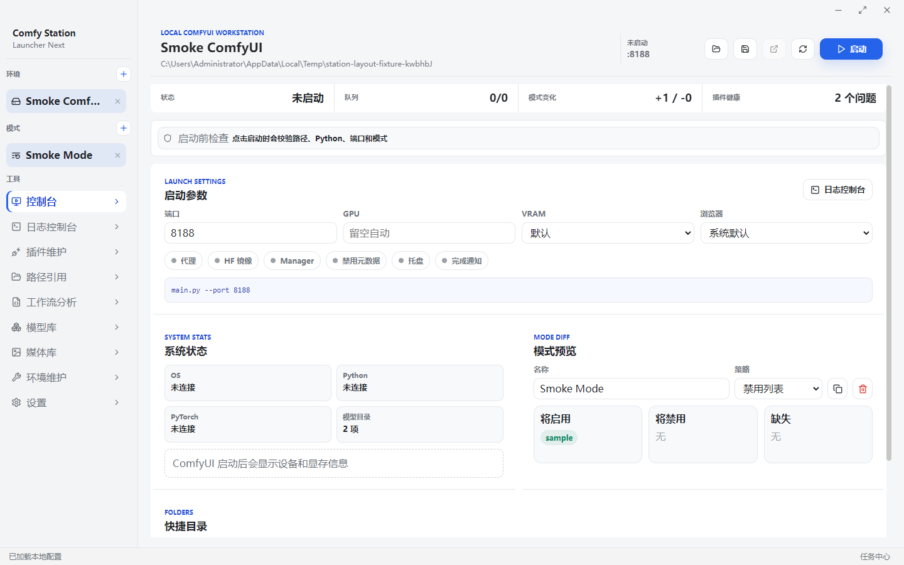
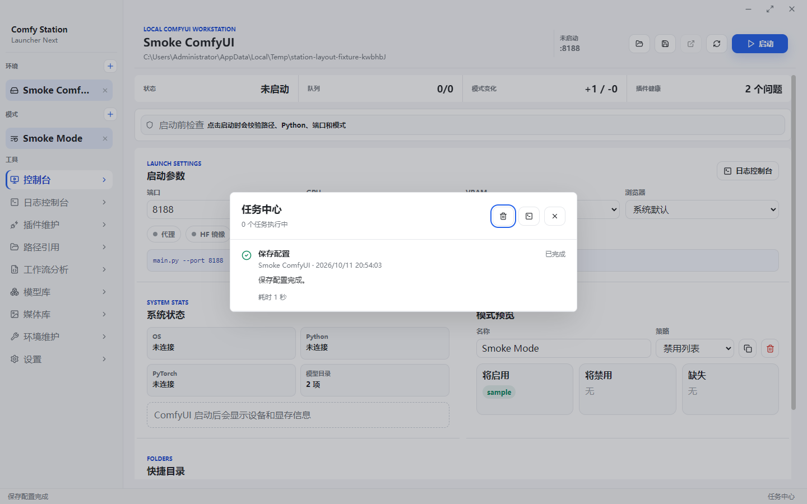

# ComfyUI Launcher Next

<p align="center">
  <a href="./README.md"><b>中文</b></a>
  ·
  <a href="./README.en.md"><b>English</b></a>
</p>

<p align="center">
  <a href="#下载">下载</a>
  ·
  <a href="#首次使用">首次使用</a>
  ·
  <a href="#核心功能">核心功能</a>
  ·
  <a href="#任务中心">任务中心</a>
  ·
  <a href="#插件维护">插件维护</a>
  ·
  <a href="#日志控制台">日志控制台</a>
  ·
  <a href="#媒体库">媒体库</a>
  ·
  <a href="#环境维护">环境维护</a>
  ·
  <a href="#开发">开发</a>
</p>

ComfyUI Launcher Next 是一个面向 Windows 本地 ComfyUI 用户的桌面启动器和工作站。

它不捆绑 ComfyUI，不接入私有服务，也不会自动导入其他启动器配置。首次使用时，只需要选择包含 `main.py` 的 ComfyUI 目录和该环境使用的 Python 可执行文件。



截图使用加载完成的示例环境，展示 0.1.3 界面，不包含用户的真实模型或配置。

## 适合谁

- 经常在本机运行 ComfyUI，希望有一个干净的桌面控制台。
- 有多个 ComfyUI 环境，需要按项目或工作流切换。
- 经常维护 `custom_nodes`，需要查看 Git 状态、备份、恢复、更新和禁用插件。
- 希望启动失败时直接看到日志、缺包、端口占用、显存不足等诊断线索。
- 希望快速浏览模型目录和 ComfyUI 输出图片、视频。

## 核心功能

### 任务中心

- 点击窗口最底部状态栏右侧的“任务中心”打开；操作进行时，该入口显示执行中的任务数量。
- 查看启动、扫描、安装、更新等操作的状态、失败原因、所属环境和耗时。
- 本地保留最近 80 个结束任务；重新打开软件后，未结束的任务标为“结果未确认”，不会自动重试。
- 支持清除已结束记录和跳转日志控制台。当前不提供安装百分比或取消子进程。



### 本地环境管理

- 手动创建多个 ComfyUI 环境。
- 首次启动进入路径配置向导，并检测 `main.py`、Python 和常用目录是否存在。
- 每个环境保存 ComfyUI 路径、Python 路径、端口、GPU、浏览器、代理、HF 镜像和额外启动参数。
- 支持系统默认浏览器、常见浏览器或自定义浏览器路径。
- 删除环境只删除本软件配置，不删除 ComfyUI 文件。

### 启动控制台

- 启动、停止、重启 ComfyUI。
- 启动前校验 ComfyUI 路径、Python、`main.py` 和端口状态。
- 端口被占用时显示处理入口。
- 生成启动参数预览，便于确认实际执行内容。
- 支持端口、CUDA 设备、VRAM 模式、代理、HF 镜像、Manager、禁用元数据等常用开关。
- 打包版隐藏后端命令行窗口，只保留前端界面。

### 日志控制台

- 实时显示 ComfyUI stdout/stderr。
- 自动跟随最新日志；用户手动滚动后暂停跟随。
- 支持错误、警告筛选。
- 支持复制、清空和导出日志。
- 自动识别常见问题：缺 Python 包、缺失节点、端口占用、CUDA out of memory、traceback 等。
- 支持中断生成、清空队列、释放模型相关内存、打开网页。

### 模式管理

- 创建、复制、重命名和删除模式。
- 每个模式维护启用插件列表、禁用插件列表和应用策略。
- 支持“禁用列表”和“仅启用列表”两种策略。
- 启动前可预览将启用、将禁用和缺失的插件。
- 可从工作流分析结果生成临时模式。

### 插件维护

- 扫描 `custom_nodes` 和 `custom_nodes\.disabled`。
- 显示插件名称、启用状态、健康状态、Git 分支、commit、remote、requirements 状态。
- 检测重复插件、缺少 Git remote、detached HEAD、requirements 等问题。
- 支持打开插件目录、启用/禁用插件、安装 GitHub 插件、更新 Git 插件。
- 更新前创建插件备份，失败后可从备份恢复。
- 支持为本地插件绑定 Git remote。
- 安装 GitHub 插件后，如果存在 `requirements.txt`，会询问是否安装依赖。

### 路径引用

- 管理额外模型、插件、工作流、输入、输出和用户目录。
- 支持打开路径、启用/禁用路径引用。
- 可生成 ComfyUI 可识别的额外模型路径配置。
- 快捷目录面板可打开 `models`、`custom_nodes`、`input`、`output`、`user`。

### 工作流分析

- 选择 workflow JSON 文件并解析节点类型。
- 区分已匹配插件、映射到缺失插件的节点和无法确认的节点，不把未知内置节点直接认定为缺失。
- 识别模型文件名候选，在本地与引用模型目录中检查同名文件，并可跳转模型库查找。
- 基于本地插件映射创建临时模式；分析不完整时采用保守模式，保留其他插件当前的启用/禁用状态。
- 可复制分析报告。
- 当前版本优先做本地分析，不依赖云端服务。
- 静态检查不保证能够运行，不检查模型版本、哈希或兼容性；动态输入可能无法识别。

### 模型库

- 扫描本地模型目录和额外模型引用目录。
- 支持 `safetensors`、`ckpt`、`pt`、`pth`、`gguf`、`onnx` 等常见模型文件。
- 展示名称、类型、大小、修改时间和所在目录。
- 支持搜索、按类型筛选、打开文件所在位置。

### 媒体库

- 浏览 ComfyUI `output` 目录中的图片和视频。
- 图片使用完整居中预览，不裁切主体。
- 视频保留原生播放控件。
- 卡片按钮会阻止事件冒泡，避免点击操作按钮时触发视频播放。
- 支持打开文件所在位置、删除输出文件、刷新列表。
- ComfyUI 运行时可读取 `/history`。

### 环境维护

- 查看 Python、PyTorch、TorchVision、TorchAudio、xformers、Triton、SageAttention、Nunchaku 等关键包状态。
- 支持运行 `pip list`。
- 支持安装 ComfyUI `requirements.txt` 和插件 `requirements.txt`。
- 支持常用依赖安装入口。
- 支持检测和更新 ComfyUI Git 内核。
- 有本地改动时会阻止直接更新 ComfyUI 内核，避免覆盖用户修改。

### 设置与更新

- 支持导出、导入和重置本软件配置。
- 支持复制当前配置 JSON，便于排查问题。
- 支持检查 GitHub Releases 上的软件新版本，并手动打开 Release 页面下载。

## 下载

打开 [Releases](https://github.com/lhhkuki/comfyui-launcher-next/releases) 页面，下载：

```text
ComfyUI Launcher Next Setup 0.1.3.exe
ComfyUI Launcher Next 0.1.3 Portable.zip
SHA256SUMS.txt
```

说明：

- `Setup.exe` 是安装版，会创建开始菜单和桌面快捷方式。
- `Portable.zip` 是便携版，解压后直接运行 `ComfyUI Launcher Next.exe`。
- 当前安装包未签名，Windows SmartScreen 可能提示风险。请确认来源后再运行。

## 首次使用

1. 打开软件后进入首次配置向导。
2. 点击 **选择 ComfyUI 根目录**，选择包含 `main.py` 的目录。
3. 软件会自动尝试识别 `python_embeded\python.exe`、`.venv\Scripts\python.exe`、`venv\Scripts\python.exe` 等常见 Python 路径。
4. 检查向导里的 `main.py`、Python、`models`、`custom_nodes`、`input`、`output`、`user` 检测结果。
5. 保存配置后进入 **控制台**，点击 **启动**。

常见便携版路径示例：

```text
D:\ComfyUI_windows_portable\ComfyUI
D:\ComfyUI_windows_portable\python_embeded\python.exe
```

## 安全边界

- 软件不会自动安装依赖、更新插件或更新 ComfyUI 内核。
- 写入或执行命令只发生在用户明确点击保存、启动、安装、更新、禁用、删除、恢复等操作之后。
- 插件启用/禁用通过目录移动实现：`custom_nodes\插件名` 和 `custom_nodes\.disabled\插件名`。
- 依赖安装使用当前环境配置的 Python，不会自动判断所有 Torch/CUDA 组合。
- 当前版本不包含私有市场、账号、VIP、自动替换更新、云端中文日志或第三方整合包专有服务。

## 数据位置

应用配置、日志和备份保存在 Electron 的用户数据目录：

```text
%APPDATA%\comfyui-launcher-next
```

主要内容：

- `launcher-next.config.json`：启动器配置。
- `logs\`：运行日志。
- `backups\`：插件备份。

## 项目结构

```text
electron/          Electron 主进程、preload 和共享类型
src/               React 前端和样式
build/             NSIS 安装脚本
scripts/           回归测试和 Windows 打包脚本
release/           本地生成的发布产物，不提交到 Git
```

## 开发

安装依赖：

```powershell
npm install
```

开发模式：

```powershell
npm run dev
```

质量检查：

```powershell
npm run test
```

也可以按模块单独运行：

```powershell
npm run test:app-model
npm run test:domain
npm run test:comfy-api
npm run test:electron-smoke
```

生成 Windows 发布包：

```powershell
npm run dist:win
```

该命令会生成便携 ZIP。如果本机能找到 `makensis.exe`，还会生成 Windows 安装包。

## 路线图

本轮完成情况与后续顺序见[产品完善计划](./docs/PRODUCT-PLAN.md)，版本更新见[0.1.3 更新说明](./docs/RELEASE-0.1.3.md)。

- 更完整的工作流节点到插件匹配能力。
- 更完善的模型、LoRA、VAE 元数据浏览。
- 更细的启动前诊断和一键修复建议。
- 便携版配置迁移工具。
- Windows 签名安装包。
- 更多语言和主题。

## License

MIT
